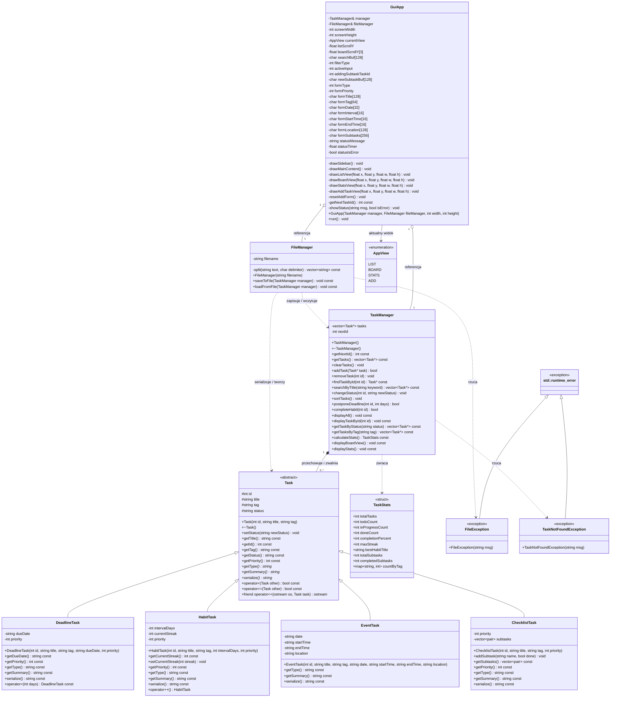

# Osobisty Menedżer Zadań (C++17 + Raylib GUI)

Aplikacja okienkowa w języku C++17 z interfejsem graficznym w stylu Notion (Raylib + `raygui`) oraz pełnym trybem konsolowym. Projekt rozdziela logikę domenową (`TaskManager`), warstwę zapisu (`FileManager`) oraz warstwę prezentacji (`GuiApp`).

## Funkcjonalności

### Interfejs graficzny (GUI)
* **Wszystkie zadania:** przewijalne karty z etykietami typów, wyszukiwarka na żywo (tytuł, tag, opis), filtrowanie po typie zadania, sortowanie po priorytecie i szybka zmiana statusu kliknięciem.
* **Akcje specjalne bezpośrednio na kartach:**
  * `DeadlineTask` – szybkie przesunięcie terminu (`+1 dzień`),
  * `HabitTask` – podbicie serii (`+1 Streak`),
  * `ChecklistTask` – interaktywne odhaczanie podzadań oraz dopisywanie nowych (`+ Podzadanie`).
* **Formularz `+ Nowe zadanie`:** dodawanie wszystkich 4 typów zadań (`Termin`, `Nawyk`, `Wydarzenie`, `Checklista`) bezpośrednio w oknie aplikacji.
* **Widok tablicy (`BoardView`):** 3 przewijalne kolumny (*Do zrobienia*, *W trakcie*, *Wykonane*) z przenoszeniem kart (`<-` / `->`).
* **Panel statystyk:** kafelki podsumowujące, ogólny pasek postępu, wykres podziału wg typów oraz liczniki serii nawyków i podzadań checklist.
* **Zapis danych:** ręczny zapis przyciskiem w pasku bocznym oraz automatyczny zapis do `tasks.txt` przy zamykaniu okna.

### Tryb konsolowy
Zachowany w pełni jako alternatywny tryb uruchamiany flagą `--console`.

## Struktura projektu

* `main.cpp` – punkt wejścia (wybór trybu GUI / `--console`) oraz menu konsolowe
* `GuiApp.h / GuiApp.cpp` – aplikacja okienkowa w Raylib i `raygui`
* `raygui.h` – jednoplikowa biblioteka kontrolek UI dla Raylib
* `Task.h / Task.cpp` – abstrakcyjna klasa bazowa zadania
* `DeadlineTask.h / .cpp` – zadania z terminem
* `HabitTask.h / .cpp` – nawyki cykliczne
* `EventTask.h / .cpp` – wydarzenia z godziną i miejscem
* `ChecklistTask.h / .cpp` – listy z podzadaniami
* `TaskManager.h / .cpp` – logika zarządzania zadaniami, sortowanie i statystyki
* `FileManager.h / .cpp` – odczyt i zapis do pliku `tasks.txt`
* `Exceptions.h` – własne klasy wyjątków

## Schemat klas UML



### Relacje w projekcie
* **Dziedziczenie (`<|--`):** `DeadlineTask`, `HabitTask`, `EventTask` oraz `ChecklistTask` dziedziczą po abstrakcyjnej klasie bazowej `Task`, implementując jej metody czysto wirtualne (`getType`, `getSummary`, `serialize`). Klasy `FileException` i `TaskNotFoundException` dziedziczą po `std::runtime_error`.
* **Kompozycja (`*--`):** `TaskManager` jest właścicielem wskaźników `Task*` i odpowiada za ich cykl życia — zniszczenie `TaskManager` automatycznie zwalnia wszystkie przechowywane zadania w destruktorze (`clearTasks()`).
* **Agregacja (`o--`):** `GuiApp` przechowuje referencje (`TaskManager&`, `FileManager&`) do obiektów utworzonych w `main()`. Zamknięcie interfejsu graficznego nie niszczy tych obiektów — ich cykl życia jest niezależny od `GuiApp`.
* **Zależności (`..>`):** `FileManager` korzysta z `TaskManager` i `Task` podczas zapisu/odczytu oraz rzuca `FileException`; `TaskManager` tworzy strukturę `TaskStats` i rzuca `TaskNotFoundException`.

## Wymagania i instalacja zależności (Windows / MSYS2 UCRT64)

1. Zainstaluj bibliotekę Raylib w terminalu **MSYS2 UCRT64**:
   ```bash
   pacman -S mingw-w64-ucrt-x86_64-raylib
   ```
2. Upewnij się, że w folderze projektu znajduje się plik `raygui.h` (jeśli go brakuje, pobierz go w PowerShellu):
   ```powershell
   Invoke-WebRequest -Uri "[https://raw.githubusercontent.com/raysan5/raygui/master/src/raygui.h](https://raw.githubusercontent.com/raysan5/raygui/master/src/raygui.h)" -OutFile "raygui.h"
   ```

## Kompilacja

```bash
g++ -std=c++17 main.cpp Task.cpp DeadlineTask.cpp HabitTask.cpp EventTask.cpp ChecklistTask.cpp TaskManager.cpp FileManager.cpp GuiApp.cpp -o task_manager.exe -lraylib -lopengl32 -lgdi32 -lwinmm
```

## Uruchomienie

* **Tryb okienkowy (domyślny):**
  ```bash
  ./task_manager.exe
  ```
* **Tryb konsolowy:**
  ```bash
  ./task_manager.exe --console
  ```

<!-- wersja dla wyświetlania wyłącznie w konsoli -->
<!-- # Osobisty Menedżer Zadań (C++17)

Obiektowa aplikacja konsolowa w języku C++17 do zarządzania zadaniami, inspirowana narzędziami typu Notion. Projekt wykorzystuje polimorfizm, dziedziczenie, własną hierarchię wyjątków oraz trwały zapis stanu do pliku tekstowego.

## Funkcjonalności

* **4 typy zadań (polimorfizm):**
  * `DeadlineTask` – zadania z terminem realizacji (`RRRR-MM-DD`) i priorytetem,
  * `HabitTask` – nawyki cykliczne z interwałem dni oraz licznikiem serii (*Streak*),
  * `EventTask` – wydarzenia z datą, przedziałem godzinowym i miejscem,
  * `ChecklistTask` – listy z podzadaniami i obliczaniem procentu postępu.
* **Widoki i organizacja:**
  * lista wszystkich zadań,
  * widok tablicy (`BoardView`) z podziałem na statusy (*Do zrobienia*, *W trakcie*, *Wykonane*),
  * panel statystyk postępu.
* **Zarządzanie zadaniami:** dodawanie, usuwanie, zmiana statusu, sortowanie po priorytecie i tytule, wyszukiwanie i filtrowanie oraz akcje specjalne (przesuwanie terminu, oznaczanie nawyku, odhaczanie podzadań checklisty).
* **Trwały zapis:** automatyczne wczytywanie przy starcie oraz zapis do pliku `tasks.txt`.

## Struktura projektu

* `main.cpp` – punkt wejścia i interfejs menu konsolowego
* `Task.h / Task.cpp` – abstrakcyjna klasa bazowa zadania
* `DeadlineTask.h / .cpp` – zadania z terminem
* `HabitTask.h / .cpp` – nawyki
* `EventTask.h / .cpp` – wydarzenia
* `ChecklistTask.h / .cpp` – checklisty z podzadaniami
* `TaskManager.h / .cpp` – logika zarządzania kolekcją zadań, sortowanie, filtrowanie i widoki
* `FileManager.h / .cpp` – serializacja i deserializacja pliku `tasks.txt`
* `Exceptions.h` – własne klasy wyjątków (`FileException`, `TaskNotFoundException`)

## Wymagania i kompilacja

Wymagany kompilator obsługujący **C++17** (np. `g++` w środowisku MSYS2 UCRT64):

```bash
g++ -std=c++17 main.cpp Task.cpp DeadlineTask.cpp HabitTask.cpp EventTask.cpp ChecklistTask.cpp TaskManager.cpp FileManager.cpp -o task_manager.exe
```

## Uruchomienie

```bash
./task_manager.exe
``` -->
